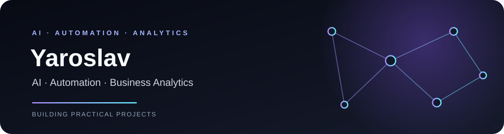

  
  
<strong>AI · Automation · Business Analytics</strong>

  
Building practical learning projects with Python, LLM integrations, workflow automation and data analysis.

  
<a href="https://yaroslav-portfolio.yaroslav-prokoshkin2134.workers.dev/">Portfolio</a> · <a href="https://github.com/sk8teJ">Repositories</a>

---

## About

I am a Business Informatics graduate and a part-time Master's student in Applied Informatics, focused on information technologies and artificial intelligence.

I build educational projects to practice applied AI, automation and business analytics. The repositories below describe the functionality I have implemented and tested; they are personal learning projects, not commercial deployments.

## Selected projects

| Project | Focus | Technologies |
|---|---|---|
| [AI Knowledge Assistant](https://github.com/sk8teJ/ai-knowledge-assistant) | RAG-based document search, answers with sources, document management and basic retrieval/generation checks | Python, Streamlit, Gemini, ChromaDB |
| [AI Request Manager](https://github.com/sk8teJ/ai-request-manager) | Telegram request classification, routing, notifications and analytics workflows | n8n, Google Gemini, Telegram |
| [Business Process Analytics](https://github.com/sk8teJ/business-process-analytics) | SQL analysis, operational dashboard and scenario-based automation ROI calculator using synthetic data | PostgreSQL, SQL, Pandas, Streamlit, Plotly |

## Tools I have used

  
  
  
  
  
  
  
  
  

## Education

- **Bachelor's degree, Business Informatics** — 2026
- **Master's degree, Applied Informatics: Information Technologies and Artificial Intelligence** — started in 2026, part-time

## Links

- Portfolio website: [yaroslav-portfolio](https://yaroslav-portfolio.yaroslav-prokoshkin2134.workers.dev/)
- GitHub: [@sk8teJ](https://github.com/sk8teJ)
